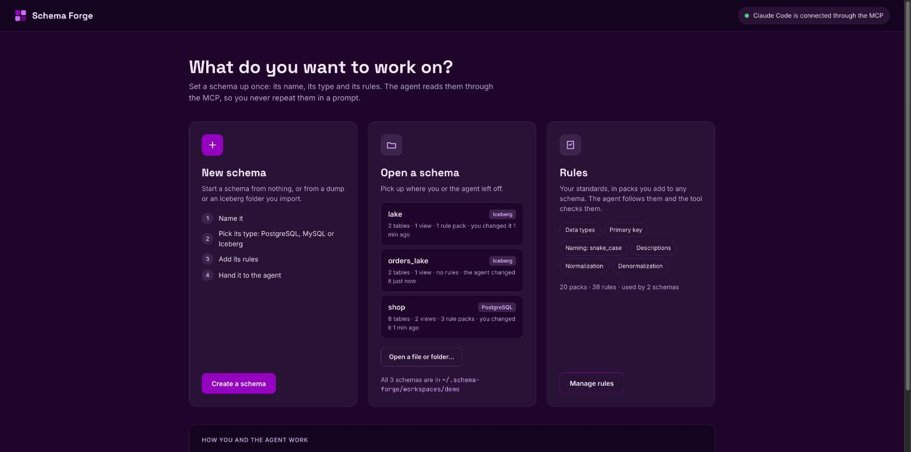
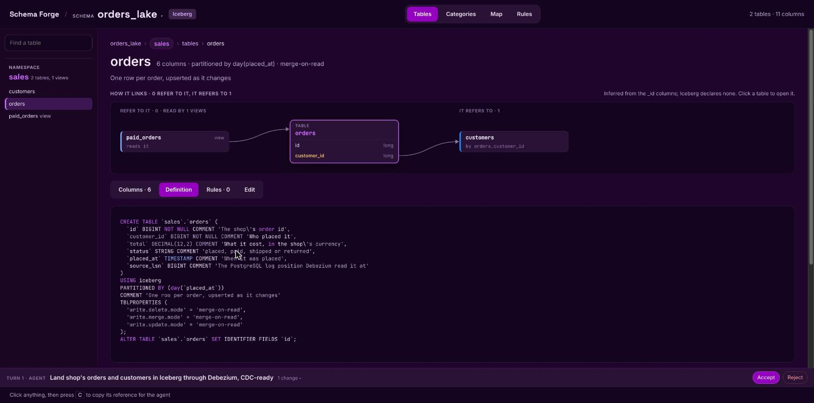
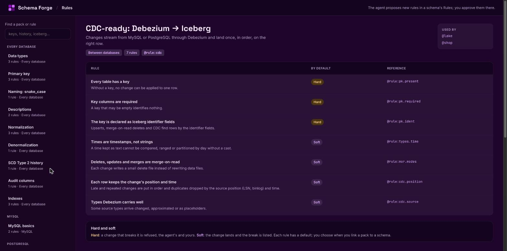

# Schema Forge

**Design database schemas with your coding agent, under standards that hold.**

AI agents now change code faster than anyone can review it, and the database schema is where their mistakes stick: a
wrong type, a missing key or a dropped column outlives every commit that caused it. Each prompt invents its own
conventions, and the same data flows from MySQL or PostgreSQL through Debezium into an Iceberg lakehouse, where one
careless change breaks the rest.

Schema Forge is an open-source schema designer where an AI coding agent and an architect work on the same live
design, and nothing lands unchecked. The agent designs through **MCP** (the protocol agents like Claude Code use to
work with tools); the architect watches every change land on a live canvas, steers it, or edits by hand. Every change,
the agent's and the architect's, is checked against **rules**: the team's design standards, written down once.

> **Status:** a working prototype proved the whole loop (see it below; tag
> [`prototype`](https://github.com/k8nstantin/schema-forge/tree/prototype)). The product is being rebuilt in the open
> on a plugin architecture, with Apache DataFusion at its center: [where it stands](#where-it-stands).



## What it does

- **An agent and an architect on one live model.** Claude Code (or any MCP agent) changes the schema one checked
  operation at a time; every change lands at once on the canvas. Point at anything (`@orders.customer_id`), paste it
  into a prompt, and the agent knows exactly what is meant. The agent's changes for one prompt form a **turn**,
  accepted or rejected whole, and never rejected when that would leave the schema broken.
- **Rules, designed ahead and enforced.** "Every table has a primary key", "money is decimal, never float", "every
  timestamp has a time zone". Rules are linked before design starts (to every schema, a schema, a namespace, a group
  of tables, or one table) and every change is checked as it happens: a **hard** rule refuses a change that breaks
  it, for the agent and the architect alike; a **soft** rule lets it land and shows the break.
- **The agent designs rules too.** It reads a schema and proposes rules with its evidence ("2 of 2 `_at` columns are
  already zoned"); the system verifies each one (is it written right, does it repeat or contradict a rule, what would
  it break); the architect approves it, hard or soft; from then on it is enforced.
- **Compatible across databases.** PostgreSQL, MySQL and Apache Iceberg first: checks name every type that would be
  lost, widened or approximated in a move between them, with the reason.
- **CDC as a goal.** Say what a schema has to do ("feed it by CDC", "land PostgreSQL in Iceberg") and Schema Forge
  shows the gap: keys Debezium can follow, identifier fields, merge-on-read, source positions, types Debezium carries
  well.
- **Starts from what exists.** It reads `pg_dump` files and Iceberg's Spark SQL today (`mysqldump` and Iceberg table
  metadata are being added), and keeps exactly as written whatever it does not model.

## Who it is for

- **Data architects** designing a lakehouse: Iceberg tables with partition specs, identifier fields and
  merge-on-read, landed from operational databases by Debezium.
- **Application architects** who want the schema behind a service to follow the same standards every time, and to
  know before a migration what would break.
- **Schema designers and data engineers** working with a coding agent, who want the agent fast and the result
  right.
- **Platform teams** writing the standards everyone else designs under.

## See it

From the prototype; the product keeps these screens, built from the same designs.

**The agent designs; you watch, then accept or reject the turn.** The agent was asked to land a shop's orders and
customers in Iceberg through Debezium. Its tables arrived through the MCP, partitioned by day, merge-on-read, keyed
by identifier fields, with a view on top. The turn waits at the bottom.


**The SQL it means**, written for the target: here Spark SQL for Iceberg.



**The agent proposes rules; the system verifies them; you approve.** Each proposal carries the agent's evidence
and the system's checks, and is approved hard or soft.


**The rules a schema follows, and what breaks them.** Every rule linked to the schema, how it holds, and what
passes and fails on the schema as it is now.


**Will it survive the move?** The PostgreSQL → Iceberg pack on a PostgreSQL schema: five columns would not cross
cleanly, each named with the reason.


**Rule packs you add to any schema.** CDC-ready: Debezium → Iceberg, and what each of its rules asks.



**Every new schema: name, type, rules, agent.** A new schema has no rules until you add them, each pack hard or
soft.


## Every database is a plugin

You choose a schema's database first, and everything follows it. Schema Forge is built in two layers that never mix:

- **The process is shared.** The screens, turns, undo, history, references, the rules machinery and the MCP work the
  same for every database and know none of them.
- **The database is its engine's.** Table kinds, types, keys and constraints, indexes, options, partitioning, the
  operations that change them, its rules, its SQL, and reading it in from a dump, definition files or the live
  database all belong to its **engine**: one Rust crate per database, its versions inside it.

Every engine stores its data in **one shared layout** (keys, checks, indexes, partitioning, defaults, identity…) and
**declares its own options** as data, so no engine grows a storage of its own. Engines share nothing with each other
but that interface: a problem in one is found in that one and never breaks another. People **add onto** an engine
with add-ons (PostGIS types, a company's conventions) without forking it. A **conformance kit** checks every engine,
and **CI checks the architecture itself**: a database named outside its engine, or one engine depending on another,
fails the build. **Adding a database needs no change to the core.** Every decision and why:
[docs/engines.md](docs/engines.md); how to write one: [docs/writing-an-engine.md](docs/writing-an-engine.md).

## How it works

```
 you ──── canvas (browser) ────┐
                               ├──► schema-forge serve ──► the model, the rules, every change logged
 agent ── MCP (Claude Code) ───┘          │
                                          └──► checked on every change: the model's own rules, your hard rules
```

You and the agent take the same path: **schema → type → rules → design**. The agent never designs before it knows
the schema's type and has read its rules.

The prototype's MCP tools, which the product keeps:

| The agent asks for | MCP tools |
|---|---|
| the schema | `schemas`, `describe` |
| its rules | `rules` (what holds, in plain words), `check` (what breaks, hard or soft), `catalog` (every rule, and the grammar new ones are written in) |
| new rules | `propose_rules` (a new rule as a sentence, a catalog rule to link, an exception with its reason), `proposals` |
| a design | `new_schema`; `start_turn`; `change`: operations (`add_table`, `add_column`, `alter_column`, `relate`, `add_index`, `set_identifier_fields`, `set_partition_spec`, `set_property`, views, renames, drops) applied as one change, all or none; refused with the rule and the reason when it breaks a hard rule; destructive ones need a yes |

## Where it stands

**The prototype is done.** Everything in [See it](#see-it) runs in it: the canvas, the agent's MCP, turns and undo,
the rules engine with hard and soft rules, exceptions, goals, compatibility and CDC packs, agent-proposed rules with
verification, reading pg_dumps and Iceberg Spark SQL, and writing PostgreSQL and Iceberg SQL.

**The product is being rebuilt now**, in the open, on the design in [docs/engines.md](docs/engines.md): every
database a plugin, Apache DataFusion at the center, the architecture checked by CI. Built so far: the model, the
engine interface with its registry and conformance kit, and the architecture check. Next, in order: the layout every
engine fills; the PostgreSQL, Iceberg and MySQL engines; the DataFusion layer; the store, the operations and the
rules; the server and the MCP; the canvas. Then schema management: drift against live databases, and migrations
checked before they run. Follow it in the [Engine plugins](https://github.com/k8nstantin/schema-forge/milestone/7)
milestone.

To try the prototype:

```
git clone https://github.com/k8nstantin/schema-forge && cd schema-forge && git checkout prototype
(cd canvas && npm ci && npm run build)
cargo build --release
./target/release/schema-forge serve
claude mcp add --transport http schema-forge http://127.0.0.1:7410/mcp
```

`serve` opens the prototype's canvas at `http://localhost:7410`. Create a schema there, or read one in with
`schema-forge import <pg_dump or Iceberg folder> --schema <name>` or **Open a file or folder** on Home. Then ask
your agent: *"Design `@orders_lake`: orders and customers landed from the shop's PostgreSQL by Debezium."*

The design: [docs/engines.md](docs/engines.md) (engines), [docs/rules.md](docs/rules.md) (rules),
[docs/perspectives.md](docs/perspectives.md) (the canvas), [docs/cdc.md](docs/cdc.md) (CDC to Iceberg),
[docs/store.md](docs/store.md) (storage), [docs/versions.md](docs/versions.md) (versions),
[docs/market.md](docs/market.md) (how it compares).

## Contributing

Schema Forge is meant to grow by plugins. To add a database, write an **engine**: one crate, following
[docs/writing-an-engine.md](docs/writing-an-engine.md), checked by the conformance kit. To add onto a database (an
extension's types, a company's conventions), write an **add-on** for its engine. Every change is one issue, one
branch and one pull request; `cargo fmt --check`, `cargo clippy -- -D warnings` and `cargo test` (which includes the
architecture check) must pass. See [CONTRIBUTING.md](CONTRIBUTING.md).

## Built with

Pure Rust, no C libraries. Today: **Apache Arrow**'s type system, which every engine maps its types to;
**sqlparser** for each engine's SQL; **serde** for the model. Next: **Apache DataFusion** as the query layer. The
prototype used **rmcp** for the MCP, **axum** and **tokio** for the server, **redb** for storage, and a React and
TypeScript canvas.

## Licence

MIT or Apache-2.0, at your choice.
