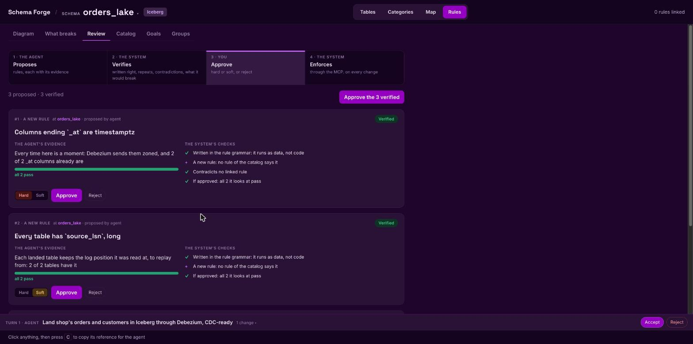
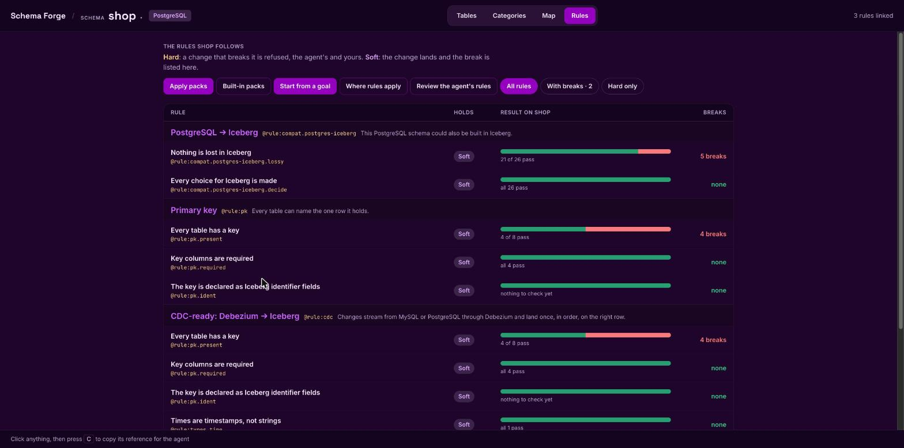

# SchemaForge

**The intelligent, multi-engine schema design and management tool, with your coding agent, under standards that hold.**
Design from scratch, reverse-engineer what exists, prompt your agent and work together, or let it design while you
watch. A schema converts from one engine to another, and its intelligence (what depends on what, what it means, what is wrong) is stored with it.

AI agents now change code faster than anyone can review it, and the database schema is where their mistakes stick: a
wrong type, a missing key or a dropped column outlives every commit that caused it. Each prompt invents its own
conventions, and the same data flows from MySQL or PostgreSQL through Debezium into an Iceberg lakehouse, where one
careless change breaks the rest.

SchemaForge is an open-source, multi-engine schema design and management tool where an AI coding agent and an architect work on the same live
design, and nothing lands unchecked. The agent designs through **MCP** (the protocol agents like Claude Code use to
work with tools); the architect watches every change land on a live canvas, steers it, or edits by hand. Every change,
the agent's and the architect's, is checked against **rules**: the team's design standards, written down once.

> **Status:** being built in the open, every database a plugin. The MySQL engine works today: it reads dumps, DDL
> and live servers, and writes back SQL that loads into MySQL 8.0 to 26.10. PostgreSQL and Apache Iceberg are next. A
> working prototype proved the whole loop (tag [`prototype`](https://github.com/k8nstantin/schema-forge/tree/prototype));
> the design is on [the site](https://k8nstantin.github.io/schema-forge/).


## What it does

- **An agent and an architect on one live model.** Claude Code (or any MCP agent) changes the schema one checked
  operation at a time; every change lands at once on the canvas. Point at anything (`@orders.customer_id`), paste it
  into a prompt, and the agent knows exactly what is meant. The agent's changes for one prompt form a **turn**,
  accepted or rejected whole, and never rejected when that would leave the schema broken.
- **Rules, designed ahead and enforced.** "Every table has a primary key", "money is decimal, never float", "every
  timestamp has a time zone". Rules are linked before design starts (to every schema, a schema, a namespace, a group
  of tables, or one table) and every change is checked as it happens: a **hard** rule refuses a change that breaks
  it, for the agent and the architect alike; a **soft** rule lets it land and shows the break.
- **The agent designs rules too.** It reads a schema and proposes rules with its evidence ("2 of 2 `_at` columns are
  already zoned"); the system verifies each one (is it written right, does it repeat or contradict a rule, what would
  it break); the architect approves it, hard or soft; from then on it is enforced.
- **Compatible across databases.** PostgreSQL, MySQL and Apache Iceberg first: checks name every type that would be
  lost, widened or approximated in a move between them, with the reason.
- **CDC as a goal.** Say what a schema has to do ("feed it by CDC", "land PostgreSQL in Iceberg") and SchemaForge
  shows the gap: keys Debezium can follow, identifier fields, merge-on-read, source positions, types Debezium carries
  well.
- **Starts from what exists.** It reads `mysqldump` files, hand-written DDL and the live MySQL database (the
  prototype also read `pg_dump` files and Iceberg's Spark SQL, which come back as their engines are rebuilt), and keeps
  exactly as written whatever it does not model.

## Who it is for

- **Data architects** designing a lakehouse: Iceberg tables with partition specs, identifier fields and
  merge-on-read, landed from operational databases by Debezium.
- **Application architects** who want the schema behind a service to follow the same standards every time, and to
  know before a migration what would break.
- **Schema designers and data engineers** working with a coding agent, who want the agent fast and the result
  right.
- **Platform teams** writing the standards everyone else designs under.

## See it

From the prototype; the product keeps these screens, built from the same designs.

**The agent designs; you watch, then accept or reject the turn.** The agent was asked to land a shop's orders and
customers in Iceberg through Debezium. Its tables arrived through the MCP, partitioned by day, merge-on-read, keyed
by identifier fields, with a view on top. The turn waits at the bottom.


**The SQL it means**, written for the target: here Spark SQL for Iceberg.


**The agent proposes rules; the system verifies them; you approve.** Each proposal carries the agent's evidence
and the system's checks, and is approved hard or soft.



**The rules a schema follows, and what breaks them.** Every rule linked to the schema, how it holds, and what
passes and fails on the schema as it is now.



**Will it survive the move?** The PostgreSQL → Iceberg pack on a PostgreSQL schema: five columns would not cross
cleanly, each named with the reason.


**Rule packs you add to any schema.** CDC-ready: Debezium → Iceberg, and what each of its rules asks.


**Every new schema: name, type, rules, agent.** A new schema has no rules until you add them, each pack hard or
soft.


## Every database is a plugin

You choose a schema's database first, and everything follows it. SchemaForge is built in two layers that never mix:

- **The process is shared.** The screens, turns, undo, history, references, the rules machinery and the MCP work the
  same for every database and know none of them.
- **The database is its engine's.** Table kinds, types, keys and constraints, indexes, options, partitioning, the
  operations that change them, its rules, its SQL, and reading it in from a dump, definition files or the live
  database all belong to its **engine**: one Rust crate per database, its versions inside it.

Every engine stores its data in **one shared layout** (keys, checks, indexes, partitioning, defaults, identity…) and
**declares its own options** as data, so no engine grows a storage of its own. Engines share nothing with each other
but that interface: a problem in one is found in that one and never breaks another. People **add onto** an engine
with add-ons (PostGIS types, a company's conventions) without forking it. A **conformance kit** checks every engine,
and **CI checks the architecture itself**: a database named outside its engine, or one engine depending on another,
fails the build. **Adding a database needs no change to the core.** Every decision and why:
[docs/engines.md](docs/engines.md); how to write one: [docs/writing-an-engine.md](docs/writing-an-engine.md).

## How it works

```
 you ──── canvas (browser) ────┐
                               ├──► schema-forge serve ──► the model, the rules, every change logged
 agent ── MCP (Claude Code) ───┘          │
                                          └──► checked on every change: the model's own rules, your hard rules
```

You and the agent take the same path: **schema → type → rules → design**. The agent never designs before it knows
the schema's type and has read its rules.

The prototype's MCP tools, which the product keeps:

| The agent asks for | MCP tools |
|---|---|
| the schema | `schemas`, `describe` |
| its rules | `rules` (what holds, in plain words), `check` (what breaks, hard or soft), `catalog` (every rule, and the grammar new ones are written in) |
| new rules | `propose_rules` (a new rule as a sentence, a catalog rule to link, an exception with its reason), `proposals` |
| a design | `new_schema`; `start_turn`; `change`: operations (`add_table`, `add_column`, `alter_column`, `relate`, `add_index`, `set_identifier_fields`, `set_partition_spec`, `set_property`, views, renames, drops) applied as one change, all or none; refused with the rule and the reason when it breaks a hard rule; destructive ones need a yes |

## The database at the core

**One PostgreSQL. Your design, its rules, its history and its vectors, in one place, for one person or a whole team.**

> Designed and specified ([specs/](specs/)), and being built now, in the order the spec gives.

**Visit the site:** [k8nstantin.github.io/schema-forge](https://k8nstantin.github.io/schema-forge/).

**Read the design**, with its diagrams, every table and every decision:
[Start here](https://k8nstantin.github.io/schema-forge/start.html) ·
[Engines](https://k8nstantin.github.io/schema-forge/engines.html) (every database a plugin; Iceberg; converting both ways) ·
[The database](https://k8nstantin.github.io/schema-forge/database.html) ·
[The owner template](https://k8nstantin.github.io/schema-forge/template.html) (how an engine or a feature adds its tables) ·
[The build spec](https://k8nstantin.github.io/schema-forge/build-spec.html) (how coding agents build it). Every page is generated from the repository
([docs/pages/](docs/pages/)).

- **Real PostgreSQL, bundled.** SchemaForge ships PostgreSQL 18 with **pgvector** inside the app: nothing to install,
  nothing to configure. On a laptop, each workspace runs its own private cluster behind a Unix socket. For a team, point
  it at a central PostgreSQL server: **the same code, the same schema, only the connection changes.**
- **The metadata and the vectors in one database.** Every object, column, relationship and rule sits beside its
  embedding. One SQL query can ask by meaning (*tables about billing*), by structure (*with a key to customers*) and by
  lineage (*and everything that reads them*) together, with no second store to sync and no index left out of date.
- **Fresh on every change.** The log knows exactly which objects a turn touched, so only those are embedded again. What
  the agent finds is what is on the canvas, as you draw or as it designs.
- **Guarded by the database itself.** Foreign keys, typed and checked columns, and rules PostgreSQL enforces at every
  commit hold for one user and for a hundred: two people's changes can never together break what each one kept, because
  every write runs `SERIALIZABLE`.
- **Your choice of embeddings, like your choice of server.** A model bundled and run locally, so nothing leaves the
  machine, or a remote one, an API or the team server's own, so everyone shares one model and one index.

**Point it at the database you have, and get to know it.** Read in a live database, a dump or a folder of DDL, and
SchemaForge works out what nobody wrote down: its architecture (every object, key, index and partition as one model),
its relationships (what reads and writes what, what a change would reach), its meaning (what each object is for, found
by meaning) and its problems (each a finding with its evidence). Ask in plain words, on the canvas or through your agent.

The database is **designed first and locked**, so coding agents fall into it instead of drifting from it
([the Database page](docs/pages/database.html), [docs/store.md](docs/store.md)):

- **Every owner in its own namespace.** `cortex` is what every engine shares (objects, columns, relationships, keys,
  indexes, the log); each engine brings `engine_<id>` (`engine_mysql.table_options`); each future feature brings its own
  (`insight`, `semantic`, `rules`, `pipelines`). Nothing reaches into another owner's tables.
- **The database enforces it.** Every reference is a foreign key, every value typed and checked, every column documented
  in the database itself. A rule a foreign key cannot state is a view of the rows breaking it, which PostgreSQL turns into
  a deferred trigger: a commit that breaks a rule is refused, whoever wrote it.
- **Every change is logged.** An operation of a turn, with every row and value it changed, so undo and reject apply its
  inverse and the log rebuilds the model.
- **It grows by versions.** Each owner versions its own tables; every change adds, a rename takes two versions, and
  every release upgrades a database of every earlier version. A new database or feature starts from
  [the owner template](docs/owner-template/README.md): five table shapes, rules, migrations, proved on PostgreSQL.
- **Ready to be talked to.** An `insight` layer (dependencies, annotations, embeddings) lets a person or an agent
  search and question a design through the MCP, in plain words.

The build itself is specified ahead: [specs/](specs/) holds the root, the rules and one XML task file per branch and
pull request, which a coding agent builds from and nothing else.

## Where it stands

**The prototype is done.** Everything in [See it](#see-it) runs in it: the canvas, the agent's MCP, turns and undo,
the rules engine with hard and soft rules, exceptions, goals, compatibility and CDC packs, agent-proposed rules with
verification, reading pg_dumps and Iceberg Spark SQL, and writing PostgreSQL and Iceberg SQL.

**The product is being rebuilt now**, in the open, on the design in [docs/engines.md](docs/engines.md): every
database a plugin, Apache DataFusion at the center, the architecture checked by CI. Built so far: the model, the
engine interface with its registry and conformance kit, the layout every engine fills, the architecture check, and
the first engine, [MySQL](engines/mysql/README.md): dumps, DDL and the live database read, every kind of object and
clause, written back in a form that loads into MySQL 8.0 to 26.10. Next, in order: the PostgreSQL and Iceberg engines;
the DataFusion layer; the store, the operations and the rules; the server and the MCP; connections; the canvas. Then schema management: drift against live databases, and migrations
checked before they run. Follow it in the [Engine plugins](https://github.com/k8nstantin/schema-forge/milestone/7)
milestone.

To try the prototype:

```
git clone https://github.com/k8nstantin/schema-forge && cd schema-forge && git checkout prototype
(cd canvas && npm ci && npm run build)
cargo build --release
./target/release/schema-forge serve
claude mcp add --transport http schema-forge http://127.0.0.1:7410/mcp
```

`serve` opens the prototype's canvas at `http://localhost:7410`. Create a schema there, or read one in with
`schema-forge import <pg_dump or Iceberg folder> --schema <name>` or **Open a file or folder** on Home. Then ask
your agent: *"Design `@orders_lake`: orders and customers landed from the shop's PostgreSQL by Debezium."*

The design: [docs/engines.md](docs/engines.md) (engines), [docs/rules.md](docs/rules.md) (rules),
[docs/perspectives.md](docs/perspectives.md) (the canvas), [docs/cdc.md](docs/cdc.md) (CDC to Iceberg),
[docs/store.md](docs/store.md) (storage), [docs/versions.md](docs/versions.md) (versions),
[docs/market.md](docs/market.md) (how it compares).

## Contributing

**A collaborative learning exercise: data products, coding with agents and spec-driven development, learned by
building one together.** You need no experience to join, and you cannot break anything: start with a question, a
sample of real DDL, or by pointing your agent at the brief. It is built with coding agents, and contributed the same way. SchemaForge builds two things at once: the product, and
the method it is built by, where people and coding agents develop together. A design session writes the work as a
task file; one agent builds it in one session; gates and a person's review decide; a build's lesson improves the
method. You contribute exactly the way the maintainer builds, with your own agent, and the method is yours to improve
too. Everyone is welcome, and every part you touch teaches databases from the inside.

**With a coding agent?** Point it at the brief: *"Read https://k8nstantin.github.io/schema-forge/agents.xml and every
file it lists, in its order, then tell me what SchemaForge is and which task or issue fits me."* It reads the whole
spec, in order, and reports back before anything changes ([how it goes](https://k8nstantin.github.io/schema-forge/contribute.html)).

## Built with

The app is Rust; its store is a **PostgreSQL 18** it bundles, with **pgvector**, built by the project's CI from the
official source and pinned by checksums. Today: **Apache Arrow**'s type system, which every engine maps its types to;
**sqlparser** for each engine's SQL; **serde** for the model. Next: **Apache DataFusion** as the query layer. The
prototype used **rmcp** for the MCP, **axum** and **tokio** for the server, **redb** for storage, and a React and
TypeScript canvas.

## Licence

MIT or Apache-2.0, at your choice.
