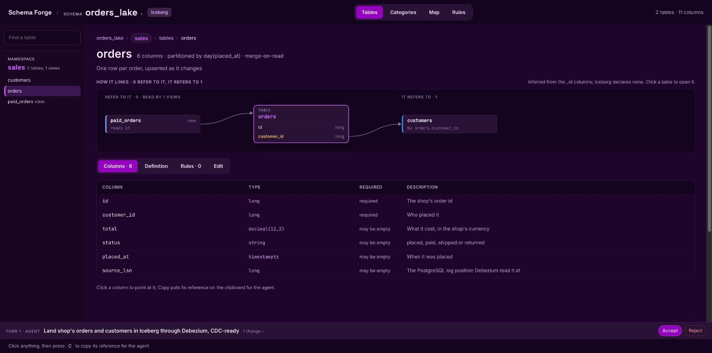

# Schema Forge

**Design database schemas with your coding agent, under standards that hold.**

Schema Forge is the first schema design tool built for an AI coding agent and a human architect to work on the
same schema at the same time. The agent designs through **MCP**; you watch every change land on a live canvas,
steer it, or make changes by hand. And everything is checked against **rules**: standards you can design with
the agent, approve, and have enforced on every change, the agent's and yours.

One model, three targets: **MySQL, PostgreSQL and Apache Iceberg**. It designs schemas that are **compatible
across them**, and **CDC-ready**: MySQL or PostgreSQL streamed by **Debezium into Iceberg**, landed optimally.


## Why it is different

Plenty of tools draw schemas. A few let an agent edit SQL. None does all of this:

- **An agent and a human, on one live model.** Claude Code (or any MCP agent) changes the schema through Schema
  Forge's MCP, one checked operation at a time. You see it land at once, in every perspective. Point at anything
  (`@orders.customer_id`), paste it into your prompt, and the agent knows exactly what you mean.
- **Rules designed ahead, then enforced.** Standards are not a lint pass at the end. They are linked to the schema
  before design starts (globally, to a schema, a namespace, a family, a group of tables, or one table) and every
  change is checked against them as it happens. **Hard** rules refuse a change that breaks them, for the agent
  *and* for you. **Soft** rules let it land and show the break.
- **The agent designs the rules too.** Nobody knows every rule ahead. So the agent reads your schema and proposes
  rules with its evidence ("2 of 2 `_at` columns are already zoned"). **The system verifies** each one (is it
  written right? does it repeat a rule? contradict one? what would it break?), **you approve** it, hard or soft,
  and from then on **the system enforces** it.
- **Compatibility by design.** Built-in rule packs check that a schema survives the move between engines:
  PostgreSQL → Iceberg, MySQL → Iceberg, MySQL ↔ PostgreSQL, Iceberg → either. Every type that would be lost,
  widened or approximated is named, with the reason.
- **CDC as a goal, not an afterthought.** Say what the schema has to do ("feed it by CDC", "move PostgreSQL to
  Iceberg") and Schema Forge links the packs it needs and shows the gap: keys Debezium can follow, identifier
  fields, merge-on-read, source positions for ordering, types Debezium carries well.
- **Turns you accept or reject whole.** The agent's changes for one prompt form a turn. Accept it, or reject it and
  every change is taken back at once, but never when that would leave the schema broken.

## Who it is for

- **Data architects** designing a lakehouse: Iceberg tables with partition specs, identifier fields and
  merge-on-read, landed from operational databases by Debezium.
- **Application architects** who want the schema behind a service to follow the same standards every time, and to
  know before a migration what would break.
- **Schema designers and data engineers** working with a coding agent, who want the agent fast and the result
  right.
- **Platform teams** writing the standards everyone else designs under.

## See it

**The agent designs; you watch, then accept or reject the turn.** The agent was asked to land a shop's orders and
customers in Iceberg through Debezium. Its tables arrived through the MCP, partitioned by day, merge-on-read, keyed
by identifier fields, with a view on top. The turn waits at the bottom.



**The SQL it means**, written for the target: here Spark SQL for Iceberg.


**The agent proposes rules; the system verifies them; you approve.** Each proposal carries the agent's evidence
and the system's checks, and is approved hard or soft.


**The rules a schema follows, and what breaks them.** Every rule linked to the schema, how it holds, and what
passes and fails on the schema as it is now.


**Will it survive the move?** The PostgreSQL → Iceberg pack on a PostgreSQL schema: five columns would not cross
cleanly, each named with the reason.


**Rule packs you add to any schema.** CDC-ready: Debezium → Iceberg, and what each of its rules asks.


**Every new schema: name, type, rules, agent.** A new schema has no rules until you add them, each pack hard or
soft.


## Every database is a plugin

You choose a schema's database first, and everything follows it. Schema Forge is built in two layers that never mix:

- **The process is shared.** The screens, turns, undo, history, references, the rules machinery and the MCP work the
  same for every database and know none of them.
- **The database is its engine's.** Table kinds, types, keys and constraints, indexes, options, partitioning, the
  operations that change them, its rules, its SQL, and reading it in from a dump, definition files or the live
  database all belong to its **engine**: one Rust crate per database, its versions inside it.

Every engine stores its data in **one shared layout** (keys, checks, indexes, partitioning, defaults, identity…) and
**declares its own options** as data, so no engine grows a storage of its own. Engines share nothing with each other
but that interface: a problem in one is found in that one and never breaks another. People **add onto** an engine
with add-ons (PostGIS types, a company's conventions) without forking it. A **conformance kit** checks every engine,
and **CI checks the architecture itself**: a database named outside its engine, or one engine depending on another,
fails the build. **Adding a database needs no change to the core.** Every decision and why:
[docs/engines.md](docs/engines.md); how to write one: [docs/writing-an-engine.md](docs/writing-an-engine.md).

## How it works

```
 you ──── canvas (browser) ────┐
                               ├──► schema-forge serve ──► the model, the rules, every change logged
 agent ── MCP (Claude Code) ───┘          │
                                          └──► checked on every change: the model's own rules, your hard rules
```

You and the agent take the same path: **schema → type → rules → design**. The agent never designs before it knows
the schema's type and has read its rules.

| The agent asks for | MCP tools |
|---|---|
| the schema | `schemas`, `describe` |
| its rules | `rules` (what holds, in plain words), `check` (what breaks, hard or soft), `catalog` (every rule, and the grammar new ones are written in) |
| new rules | `propose_rules` (a new rule as a sentence, a catalog rule to link, an exception with its reason), `proposals` |
| a design | `new_schema`; `start_turn`; `change`: operations (`add_table`, `add_column`, `alter_column`, `relate`, `add_index`, `set_identifier_fields`, `set_partition_spec`, `set_property`, views, renames, drops) applied as one change, all or none; refused with the rule and the reason when it breaks a hard rule; destructive ones need a yes |

## Where it stands

**The prototype is done.** Everything on this page runs in it: the canvas, the agent's MCP, turns and undo, the rules
engine with hard and soft rules, exceptions, goals, compatibility and CDC packs, agent-proposed rules with
verification, reading pg_dumps and Iceberg Spark SQL, and writing PostgreSQL and Iceberg SQL. It is kept as the tag
[`prototype`](https://github.com/k8nstantin/schema-forge/tree/prototype).

**The product is being built now**, new, on engine plugins ([docs/engines.md](docs/engines.md)). Done: the model,
the engine interface with its registry and conformance kit, and the design checked by CI. Next: the layout every
engine fills, then the PostgreSQL engine (the proof of the plugin design), Iceberg (with its table metadata) and
MySQL, then the store, the operations, the rules, the server and the MCP, and the canvas. Follow it in the
[Engine plugins](https://github.com/k8nstantin/schema-forge/milestone/7) milestone.

To try the prototype:

```
git clone https://github.com/k8nstantin/schema-forge && cd schema-forge && git checkout prototype
(cd canvas && npm ci && npm run build)
cargo build --release
./target/release/schema-forge serve
claude mcp add --transport http schema-forge http://127.0.0.1:7410/mcp
```

`serve` opens the canvas at `http://localhost:7410`. Create a schema there, or read one in with
`schema-forge import <pg_dump or Iceberg folder> --schema <name>` or **Open a file or folder** on Home. Then ask
your agent: *"Design `@orders_lake`: orders and customers landed from the shop's PostgreSQL by Debezium."*

The design: [docs/engines.md](docs/engines.md) (engines), [docs/rules.md](docs/rules.md) (rules),
[docs/perspectives.md](docs/perspectives.md) (the canvas), [docs/cdc.md](docs/cdc.md) (CDC to Iceberg),
[docs/store.md](docs/store.md) (storage), [docs/versions.md](docs/versions.md) (versions),
[docs/market.md](docs/market.md) (how it compares).

## Built with

Rust for the engine (pure Rust, no C libraries): **sqlparser** for SQL, **rmcp** for the MCP, **axum** and
**tokio** for the server, **redb** for storage. The canvas is React and TypeScript, served by the engine.

## Licence

MIT or Apache-2.0, at your choice.
